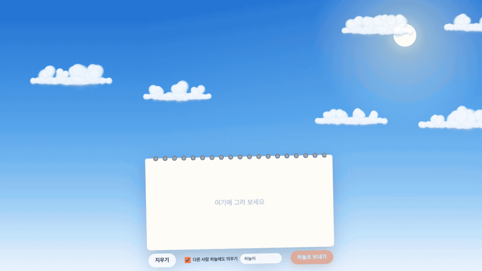

# 하늘 스케치북 — 그린 그림이 뭉게구름이 되는 하늘

스케치북에 아무거나 그리고 '하늘로 보내기'를 누르면, 그 선 모양 그대로 몽글몽글한 뭉게구름이 되어 파란 하늘로 떠올라요. 원하면 다른 사람 하늘에도 띄울 수 있고, 운영자가 검수한 구름만 닉네임과 함께 두둥실 떠올라요.

- 사이트: https://sky-doodle.pages.dev

<p align="center"><a href="docs/media/demo.mp4"></a><br>
<sub>▶ <a href="docs/media/demo.mp4">고화질 영상 (MP4)</a></sub></p>

## 만든 이유

맑은 날 하늘을 보면 구름이 꼭 뭔가를 닮아 있잖아요. 거꾸로, 내가 그린 걸 구름으로 만들어 하늘에 띄우면 어떨까 싶었어요. 혼자 그려도 누군가 그린 구름이 옆으로 흘러가면 같은 하늘을 보는 기분이 들게 하고 싶었고요.

## 어떻게 동작하나요

1. 스케치북에 선을 그어요. 종이 밖으로 나가면 펜이 떨어져요.
2. 선을 일정 간격으로 다시 뽑아 그 자리마다 구름 덩어리를 놓고, 차례로 부풀려 뭉게구름으로 바꿔요.
3. 다 자란 구름은 캔버스 한 장으로 구워서 하늘로 띄워요. 이후에는 매 프레임 이미지 한 번만 그려요.
4. '다른 사람 하늘에도 띄우기'를 켜고 보내면 검수 대기로 저장되고, 운영자가 승인하면 열어 둔 다른 사람 화면에도 새로고침 없이 떠올라요.

## 기능

- **모양 그대로 뭉게구름** — 그린 선을 따라 덩어리가 부풀어 오르는 변신 애니메이션
- **내 하늘 저장** — 보낸 구름은 브라우저에 저장돼서 다시 와도 떠 있어요(최대 18개)
- **같이 보는 하늘** — 승인된 다른 사람 구름 4개가 닉네임과 함께 흘러가고, 화면 밖으로 나가면 다른 구름으로 바뀌어요
- **검수 어드민** — `/admin`에서 승인·거절·내리기, 여러 개 한꺼번에 처리, 오늘 제출·대기 통계. Cloudflare Access로 운영자만 들어가요
- **도배 막기** — 같은 접속에서 1시간 5개, 하루 20개. 원본 IP는 저장하지 않고 소금 친 해시만 둬요
- **움직임 줄이기** — 시스템의 '동작 줄이기' 설정을 따라요

## 기술

| 영역 | 사용 |
|---|---|
| 화면 | TypeScript, Canvas 2D, Vite (프레임워크 없음) |
| 서버 | Cloudflare Pages Functions |
| 저장 | Cloudflare D1 (SQLite) |
| 어드민 보호 | Cloudflare Access + Functions에서 JWT 재검증 |

Claude Code와 함께 만들었어요.

## 로컬에서 실행

```bash
npm install
npm run dev                      # 하늘만(공유 구름 없이) http://localhost:5173

# 공유 구름·어드민까지
npm run build
npx wrangler d1 migrations apply sky-doodle --local
echo "DEV_ADMIN_BYPASS=1" > .dev.vars   # 로컬에서만 어드민 통과
npx wrangler pages dev dist      # http://localhost:8788, 어드민은 /admin/
```

## 배포

```bash
npx wrangler d1 migrations apply sky-doodle --remote
npx wrangler pages secret put IP_SALT --project-name sky-doodle             # 아무 긴 무작위 값
npx wrangler pages secret put ACCESS_TEAM_DOMAIN --project-name sky-doodle  # <팀>.cloudflareaccess.com
npx wrangler pages secret put ACCESS_AUD --project-name sky-doodle          # Access 앱의 AUD 태그
npm run deploy
```

Cloudflare Access에서 `sky-doodle.pages.dev/admin`(미리보기용 `*.sky-doodle.pages.dev/admin`)을 보호하는 자체 호스팅 앱을 만들어야 어드민이 열려요. 설정이 없으면 어드민은 항상 403이에요.

## 폴더

```
index.html, src/main.ts   하늘, 스케치북, 공유 구름
src/cloud.ts              선 → 구름 덩어리, 굽기
src/pad.ts                그리기
src/shared.ts             공유 제출·받아 오기
admin/, src/admin.ts      검수 화면
functions/                /api/clouds, /admin/api/*
migrations/               D1 스키마
docs/                     기획서·설계서·구현도·결정기록
```

## 브랜치

`main`(릴리스) · `develop`(작업) · `feature/*` `bugfix/*` `release/*` `hotfix/*`, 태그는 `vX.Y.Z`.
