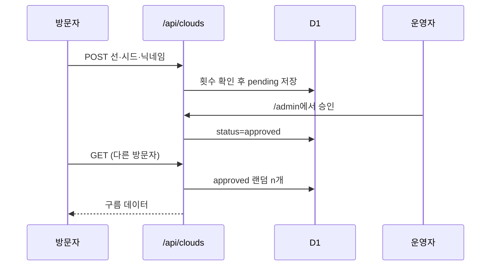

# 하늘 스케치북 구현도

## 폴더
```
index.html            하늘 + 스케치북
admin/index.html      어드민
src/
  pad.ts              그리기
  cloud.ts            선 → 구름 덩어리, 굽기
  main.ts             하늘 애니메이션, 저장, 공유 구름, 화면 키보드 높이(--kb)
  style.css           PC·폰 세로·폰 가로 배치
public/manifest.webmanifest  홈 화면에 추가(PWA) + icon-192·512, apple-touch-icon
  shared.ts           /api/clouds 호출, 공유 큐
  admin.ts            어드민 화면
functions/
  _lib.ts             공통(응답, 검증, 해시)
  api/clouds.ts       GET 승인 구름 랜덤, POST 제출
  admin/_middleware.ts Access JWT 검증
  admin/api/list.ts   상태별 목록
  admin/api/review.ts 승인·거절·내리기
  admin/api/stats.ts  통계
migrations/0001_init.sql
```

## 흐름


## 진행
| 단계 | 내용 | 상태 |
|---|---|---|
| 1 | 그림 → 구름, 로컬 저장, Pages 배포 | 완료 |
| 2 | D1 스키마, 제출·조회 API | 완료(로컬 확인) |
| 3 | 하늘에 공유 구름 + 닉네임, 체크박스 | 완료(로컬 확인) |
| 4 | 어드민 화면과 API, Access 검증 | 완료(로컬 확인, Access 실제 연결은 6단계) |
| 5 | 알림 메일 | 뺌(도메인 미사용 결정) |
| 7 | 공유 구름 두둥실 등장, 새로고침 없이 새 승인 반영 | 완료(v1.1.0) |
| 6 | Access 앱 설정(대시보드), 배포 | 완료(v1.0.0 배포, /admin 잠금 확인) |
| 8 | 모바일 웹 우선: 큰 그리는 칸, 손가락 크기 버튼, 키보드 위로 올리기, 가로 폰 배치, PWA | 완료(배포는 확인 후) |
