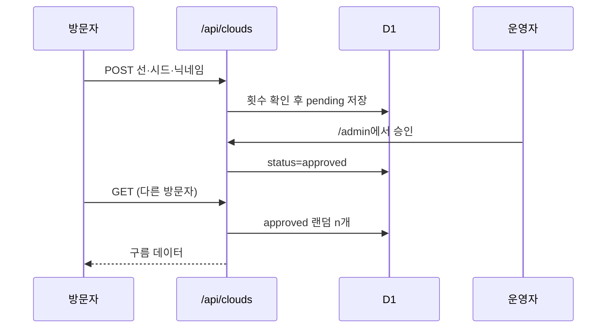

# 하늘 스케치북 구현도

## 폴더
```
index.html            하늘 + 스케치북
admin/index.html      어드민
src/
  geom.ts             선 → 구름 덩어리 계산, 다시 뽑기, 포인터 하나만 받기(PointerGate). DOM 없음
  cloud.ts            덩어리 스프라이트, 굽기, 종이 그림자, 이름 꼬리표
  pad.ts              그리기: 연필 굵기, 지우개, 되돌리기, 덧그리기
  main.ts             하늘 루프, 변신·상승, 저장, 공유 구름, 구름 고르기·밀기
  desk.ts             연필꽂이, 되돌리기, 새 종이(넘기기), 안내 종이
  note.ts             공유 묻기·이름 적기 쪽지
  backdrop.ts         움직이지 않는 하늘 층(#bg)
  skytone.ts          시각별 하늘 색 계산. DOM 없음
  export.ts           구름 PNG, 기기 공유·내려받기
  shared.ts           /api/clouds 호출, 공유 큐, 확인 간격
  store.ts            브라우저 저장 키
  fonts.css           scripts/subset_fonts.py 가 만든 @font-face
  style.css           스케치북 재료(종이·판지·연필·도장·쪽지·테이프), PC·폰 세로·폰 가로 배치
  admin.ts, admin.css 어드민 화면
public/
  manifest.webmanifest  홈 화면에 추가(PWA) + icon-192·512, apple-touch-icon
  fonts/              Gaegu 서브셋(core·ext)과 OFL.txt
  og.jpg              링크 미리보기 그림(1200×630)
functions/
  _lib.ts             공통(응답, 검증, 접속 키 ipKey, 본문 읽기, 해시)
  api/clouds.ts       GET 승인 구름(rnd 색인으로 무작위) · after 이후 승인분과 내려간 id, POST 제출
  api/clouds/status.ts 보낸 구름의 승인 여부
  api/[[path]].ts     없는 /api 경로는 404 JSON
  admin/_middleware.ts Access JWT 검증, 확인한 사람(ctx.data.who)
  admin/api/list.ts   상태별 목록
  admin/api/review.ts 승인·거절·내리기, 이름 지우고 승인, 같은 접속 한꺼번에 거절
  admin/api/stats.ts  통계
migrations/
  0001_init.sql, 0002_reviewed_idx.sql
  0003_sampling_review_log.sql  rnd 열·색인, reviewed_by, 해시 정리용 색인
tests/                node --test (geom, shared, skytone, _lib, 어드민 인증)
scripts/subset_fonts.py
.github/workflows/ci.yml  타입 검사 · 테스트 · 빌드
```

## 흐름


## 진행
| 단계 | 내용 | 상태 |
|---|---|---|
| 1 | 그림 → 구름, 로컬 저장, Pages 배포 | 완료 |
| 2 | D1 스키마, 제출·조회 API | 완료(로컬 확인) |
| 3 | 하늘에 공유 구름 + 닉네임, 체크박스 | 완료(로컬 확인) |
| 4 | 어드민 화면과 API, Access 검증 | 완료(로컬 확인, Access 실제 연결은 6단계) |
| 5 | 알림 메일 | 뺌(도메인 미사용 결정) |
| 7 | 공유 구름 두둥실 등장, 새로고침 없이 새 승인 반영 | 완료(v1.1.0) |
| 6 | Access 앱 설정(대시보드), 배포 | 완료(v1.0.0 배포, /admin 잠금 확인) |
| 8 | 모바일 웹 우선: 큰 그리는 칸, 손가락 크기 버튼, 키보드 위로 올리기, 가로 폰 배치, PWA | 완료(배포는 확인 후) |
| 9 | 2026-11 개선: 두 손가락 입력, 공유 쪽지, 내림 전파, /64·대기 상한, rnd 색인·확인 간격, 스케치북 재료 조작부·손글씨, 변신 연출, 구름 저장·보내기, 시각별 하늘, 붓·지우개, 테스트·CI | 완료(로컬 확인, 배포 전) |
