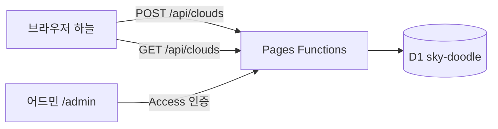

# 하늘 스케치북 설계서

## 기술 선택

| 항목 | 후보 | 고른 것 | 이유 |
|---|---|---|---|
| 서버 | Cloudflare Pages Functions / Supabase | **Pages Functions** | 이미 Pages에 배포돼 있어 같은 주소에 `/api`만 붙이면 된다. Supabase 무료 플랜은 활성 프로젝트 2개 제한 |
| 저장소 | D1(SQLite) / KV | **D1** | 상태별 목록·통계·횟수 제한에 SQL이 필요. KV는 목록·집계가 어렵다 |
| 어드민 로그인 | Cloudflare Access / 자체 비밀번호 | **Access** | 운영자 메일로 받은 일회용 코드로만 열린다. 코드에 비밀번호가 없다. Functions에서 Access 토큰(JWT)을 한 번 더 검증한다 |
| 알림 | Email Routing / Resend / 텔레그램 / 없음 | **없음** | Email Routing은 도메인이 필요한데, 다른 용도로 쓰는 도메인은 건드리지 않기로 함. 어드민 통계의 대기 개수로 확인 |

## 아키텍처

## 데이터

`clouds`
| 열 | 형 | 설명 |
|---|---|---|
| id | TEXT PK | UUID |
| seed | INTEGER | 구름 모양 난수 시드 |
| pts | TEXT | 선 데이터 JSON `number[][]`(스트로크별 x,y 평탄화, 정수) |
| nick | TEXT | 닉네임(빈 문자열 = 익명) |
| status | TEXT | `pending` `approved` `rejected` `hidden` |
| ip_hash | TEXT | SHA-256(IP + 비밀 소금). 횟수 제한용, 원본 IP는 저장하지 않음 |
| created_at / reviewed_at | INTEGER | 밀리초 |

`meta`: 키·값 설정 자리(지금은 비어 있음)

## 새 구름 반영
- 화면은 `GET /api/clouds?after=<서버 시각>`으로 그 뒤 승인된 구름(`clouds`)과 내려간 구름 id(`gone`, 상태 `hidden`)를 받는다. 승인된 구름은 내리기만 되고 거절·대기로는 못 돌린다(응답의 `now`를 다음 기준으로). 간격은 30초에서 시작해 새 것이 없으면 60초, 120초로 늘린다. 탭이 숨겨져 있거나 5분 동안 조작이 없으면 쉬고, 다시 만지면 이어 간다
- 무작위 조회는 `rnd` 열의 임의 지점에서 `(status, rnd)` 색인 순서로 n개를 읽는다(끝에 닿으면 앞에서 마저). 응답은 브라우저가 30초 보관한다
- 횟수 제한의 접속 단위: IPv4 는 주소 전체, IPv6 는 앞 64비트(`ipKey`). 한 접속의 대기는 10개까지. 14일 넘게 확인받지 못한 대기는 제출이 들어올 때(10분에 한 번, `meta.tidy_at`) 거절(`reviewed_by = 'auto'`)로 넘기고, 확인이 끝난 지 이틀 넘은 행의 접속 해시는 지운다(대기 중인 행의 해시는 확인될 때까지 남는다). 제출은 `Origin` 이 다른 사이트면 403, `content-type` 이 정확히 `application/json` 이 아니면 415. `IP_SALT` 가 없는 운영 환경은 제출을 500 으로 막는다
- 목록 응답은 캐시하지 않는다(내린 구름이 바로 빠지도록)
- 인덱스 `(status, reviewed_at)`

## 검증·제한
- 선: 스트로크 1~80개, 좌표 합계 4000개 이하, 각 좌표 정수 0~4000, 본문 64KB 이하
- 닉네임: 앞뒤 공백 제거, 제어문자 제거, 10글자 이하
- 횟수: 같은 ip_hash 1시간 5개·24시간 20개, 대기 500개 넘으면 503
- 화면 출력은 캔버스 `fillText`·`textContent`만 쓴다(HTML로 넣지 않음)

## 어드민 보안
- Cloudflare Access 애플리케이션이 `sky-doodle.pages.dev/admin*`을 막는다(허용: 운영자 메일 한 개, 이메일 일회용 코드)
- `functions/admin/_middleware.ts`가 `Cf-Access-Jwt-Assertion`을 팀 공개키로 검증하고 `aud`·`exp`·`iss`를 확인한다. 설정값이 없으면 막는다(fail closed)
- 로컬 개발만 `.dev.vars`의 `DEV_ADMIN_BYPASS=1` + 호스트 `localhost`일 때 통과

## 플랫폼
웹 하나로 PC·모바일. 앱 스토어 앱은 만들지 않는다(놀이용 한 장짜리 사이트). 2026-11-08부터 **모바일 웹이 먼저**다. 폰 세로 화면에 맞춰 만들고, PC는 지금의 넓은 배치를 그대로 둔다.

| 화면 | 배치 |
|---|---|
| 폰 세로 (폭 600px 이하) | 스케치북을 화면 폭 가득, 그리는 칸 높이는 화면의 46%(220~420px). 하늘은 위쪽 절반 |
| 폰 가로 (높이 500px 이하) | 스케치북을 오른쪽에 세우고(폭 54%, 460px까지), 구름은 스케치북 왼쪽 하늘로 보낸다(`main.ts` `SIDE_BOOK`) |
| PC | 가운데 아래 560px 스케치북(그대로) |

- 손가락 크기: 누르는 것은 높이 44px 이상(도장 46px, 연필 40×50px).
- 이름 칸 글자는 16px. 16px보다 작으면 iOS가 입력할 때 화면을 확대한다.
- 화면 키보드: `visualViewport` 로 키보드 높이를 재서, 이름을 적는 동안 쪽지를 키보드 바로 위로 옮긴다(스케치북은 그대로 둔다). 손가락으로 확대한 동안은 재지 않는다.
- 길게 눌러 생기는 메뉴·글자 선택·두 번 탭 확대를 막는다(이름 칸·안내 종이만 글자 선택 허용). 보내면 짧게 진동(`navigator.vibrate`, 되는 기기만).
- 입력(2026-11-10): 종이에 닿은 포인터 가운데 먼저 닿은 하나만 그린다(`PointerGate`). 펜이 닿으면 손이 긋던 선을 버리고 펜이 그린다. 종이가 기울어 있으므로 좌표는 캔버스 가운데를 축으로 되돌려 계산한다.
- 도구(2026-11-10): 연필 세 자루(3·5·9px, 굵기가 구름 덩어리 반지름에 곱해진다)와 지우개(문지른 획을 통째로). 되돌리기는 획 하나 또는 지우개질 한 번 단위. '새 종이'는 종이를 넘기고, 4초 동안 귀퉁이나 같은 버튼으로 되돌린다. 굵기는 내 하늘(브라우저 저장)에만 남고 공유로 보낼 때는 기본 굵기로 간다.
- 공유는 기본으로 꺼 둔다(2026-11-09). 첫 전송 뒤 구름이 하늘에 자리 잡으면 "이 구름, 다른 사람 하늘에도 띄울까요?" 쪽지가 스케치북 위쪽 가장자리에 붙는다. 종이를 덮지 않고 그리기를 막지 않으며 Esc 는 '괜찮아요'다. 이름 칸은 '띄우기'를 누른 뒤에 열린다. 답한 뒤부터 아래 공유 줄(체크 + 이름표)이 보인다. 기록 키 `sky-doodle:asked`.
- 한 번에 주인공은 하나: 구름이 변신·상승하는 동안 쪽지와 알림(테이프)은 기다렸다가 뜬다.
- 변신(2026-11-10): 연필 선이 0.3초 동안 희어지며 굵어지고(선은 사라지지 않는다) 그 위로 덩어리가 부푼다. 종이에는 구름 모양 그림자가 생겨 떠오를수록 작고 흐려진다. 떠날 때 살짝 눌렸다 늘어나고, 위로 먼저 오른 뒤 바람 쪽으로 휘어 바람 속도로 흘러가기에 이어진다. 움직임 줄이기에서는 변신을 건너뛰고 그림자만 남긴다.
- 재료(2026-11-10): 조작부는 스케치북의 것으로 만든다. 판지 뒤판 위 연필꽂이·도장(보내기), 표지 띠의 이름·되돌리기·새 종이·안내, 쪽지(공유), 마스킹테이프(알림), 종이 꼬리표(구름 이름). 모서리 6px, 원은 스프링과 체크 표시에만. 손글씨는 Gaegu(OFL) 서브셋, 긴 문장과 입력 칸은 시스템 글꼴.
- 대비: 도장 #c94a1a 바탕 종이색 글씨(4.6:1), 종이 위 연필색 #4b5a6c(6.9:1), 판지 위 글씨 #2d3a4a(5.7:1), 포커스 링은 진한 남색 + 흰 테. 구름 이름은 종이색 꼬리표 위 연필색.
- 하늘(2026-11-10): 배경은 정지 층(#bg)에 한 번 그리고 #sky 는 구름만 그린다. 가만히 흘러갈 때는 초당 30번. 방문자 시각에 따라 새벽·낮·해질녘·밤 색을 섞는다(`skyAt`). 바탕 구름은 날짜 시드.
- 구름 만지기(2026-11-10): 내 구름을 누르면 종이 쪽지(저장·보내기·내리기)가 달린다. 저장은 1080×1080 PNG, 보내기는 Web Share(파일 공유를 못 하는 브라우저에서는 버튼을 숨기고 저장만). 내리기는 두 번 눌러야 한다. 구름을 쓸면 밀려났다가 다시 바람을 탄다.
- 화면 읽기: 보내기·새 종이·되돌리기·구름 고르기 결과를 보이지 않는 알림 영역(`#sr`)으로 알려 준다.
- 홈 화면에 추가(PWA): `public/manifest.webmanifest` + 아이콘(192·512·maskable, apple-touch 180). 화면은 `standalone`. 오프라인 캐시(서비스 워커)는 넣지 않는다. 구름 목록이 서버에 있어 오프라인으로 쓸 일이 없다.
