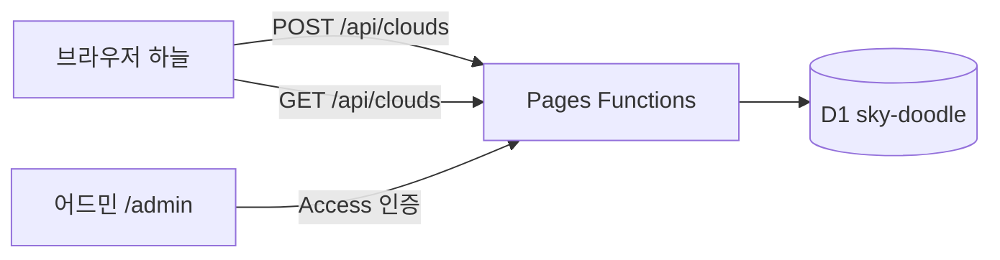

# 하늘 스케치북 설계서

## 기술 선택

| 항목 | 후보 | 고른 것 | 이유 |
|---|---|---|---|
| 서버 | Cloudflare Pages Functions / Supabase | **Pages Functions** | 이미 Pages에 배포돼 있어 같은 주소에 `/api`만 붙이면 된다. Supabase 무료 플랜은 활성 프로젝트 2개 제한 |
| 저장소 | D1(SQLite) / KV | **D1** | 상태별 목록·통계·횟수 제한에 SQL이 필요. KV는 목록·집계가 어렵다 |
| 어드민 로그인 | Cloudflare Access / 자체 비밀번호 | **Access** | 운영자 메일로 받은 일회용 코드로만 열린다. 코드에 비밀번호가 없다. Functions에서 Access 토큰(JWT)을 한 번 더 검증한다 |
| 알림 | Email Routing / Resend / 텔레그램 / 없음 | **없음** | Email Routing은 도메인이 필요한데, 다른 용도로 쓰는 도메인은 건드리지 않기로 함. 어드민 통계의 대기 개수로 확인 |

## 아키텍처

## 데이터

`clouds`
| 열 | 형 | 설명 |
|---|---|---|
| id | TEXT PK | UUID |
| seed | INTEGER | 구름 모양 난수 시드 |
| pts | TEXT | 선 데이터 JSON `number[][]`(스트로크별 x,y 평탄화, 정수) |
| nick | TEXT | 닉네임(빈 문자열 = 익명) |
| status | TEXT | `pending` `approved` `rejected` `hidden` |
| ip_hash | TEXT | SHA-256(IP + 비밀 소금). 횟수 제한용, 원본 IP는 저장하지 않음 |
| created_at / reviewed_at | INTEGER | 밀리초 |

`meta`: 키·값 설정 자리(지금은 비어 있음)

## 새 구름 반영
- 화면은 30초마다 `GET /api/clouds?after=<서버 시각>`으로 그 뒤 승인된 구름만 받는다(응답의 `now`를 다음 기준으로). 탭이 숨겨져 있으면 쉰다
- 목록 응답은 캐시하지 않는다(내린 구름이 바로 빠지도록)
- 인덱스 `(status, reviewed_at)`

## 검증·제한
- 선: 스트로크 1~80개, 좌표 합계 4000개 이하, 각 좌표 정수 0~4000, 본문 64KB 이하
- 닉네임: 앞뒤 공백 제거, 제어문자 제거, 10글자 이하
- 횟수: 같은 ip_hash 1시간 5개·24시간 20개, 대기 500개 넘으면 503
- 화면 출력은 캔버스 `fillText`·`textContent`만 쓴다(HTML로 넣지 않음)

## 어드민 보안
- Cloudflare Access 애플리케이션이 `sky-doodle.pages.dev/admin*`을 막는다(허용: 운영자 메일 한 개, 이메일 일회용 코드)
- `functions/admin/_middleware.ts`가 `Cf-Access-Jwt-Assertion`을 팀 공개키로 검증하고 `aud`·`exp`·`iss`를 확인한다. 설정값이 없으면 막는다(fail closed)
- 로컬 개발만 `.dev.vars`의 `DEV_ADMIN_BYPASS=1` + 호스트 `localhost`일 때 통과

## 플랫폼
웹 하나로 PC·모바일. 앱 스토어 앱은 만들지 않는다(놀이용 한 장짜리 사이트). 2026-11-08부터 **모바일 웹이 먼저**다. 폰 세로 화면에 맞춰 만들고, PC는 지금의 넓은 배치를 그대로 둔다.

| 화면 | 배치 |
|---|---|
| 폰 세로 (폭 600px 이하) | 스케치북을 화면 폭 가득, 그리는 칸 높이는 화면의 46%(220~420px). 하늘은 위쪽 절반 |
| 폰 가로 (높이 500px 이하) | 스케치북을 오른쪽에 세우고(폭 54%, 460px까지), 구름은 스케치북 왼쪽 하늘로 보낸다(`main.ts` `SIDE_BOOK`) |
| PC | 가운데 아래 560px 스케치북(그대로) |

- 손가락 크기: 터치 화면(`pointer: coarse`)에서 버튼 48px, 체크박스 줄·닉네임 칸 44px 이상.
- 닉네임 칸 글자는 16px. 16px보다 작으면 iOS가 입력할 때 화면을 확대한다.
- 화면 키보드: `visualViewport` 로 키보드 높이를 재서 CSS 변수 `--kb` 에 넣고, 그만큼 스케치북을 올린다. 손가락으로 확대한 동안은 재지 않는다.
- 길게 눌러 생기는 메뉴·글자 선택·두 번 탭 확대를 막는다(닉네임 칸만 글자 선택 허용). 보내면 짧게 진동(`navigator.vibrate`, 되는 기기만).
- 홈 화면에 추가(PWA): `public/manifest.webmanifest` + 아이콘(192·512·maskable, apple-touch 180). 화면은 `standalone`. 오프라인 캐시(서비스 워커)는 넣지 않는다. 구름 목록이 서버에 있어 오프라인으로 쓸 일이 없다.
